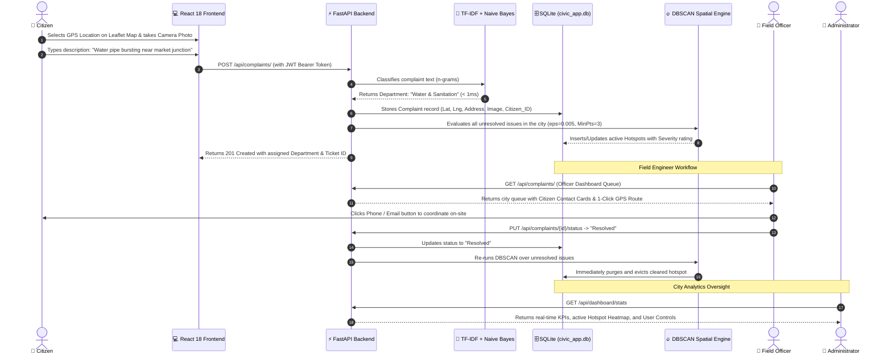
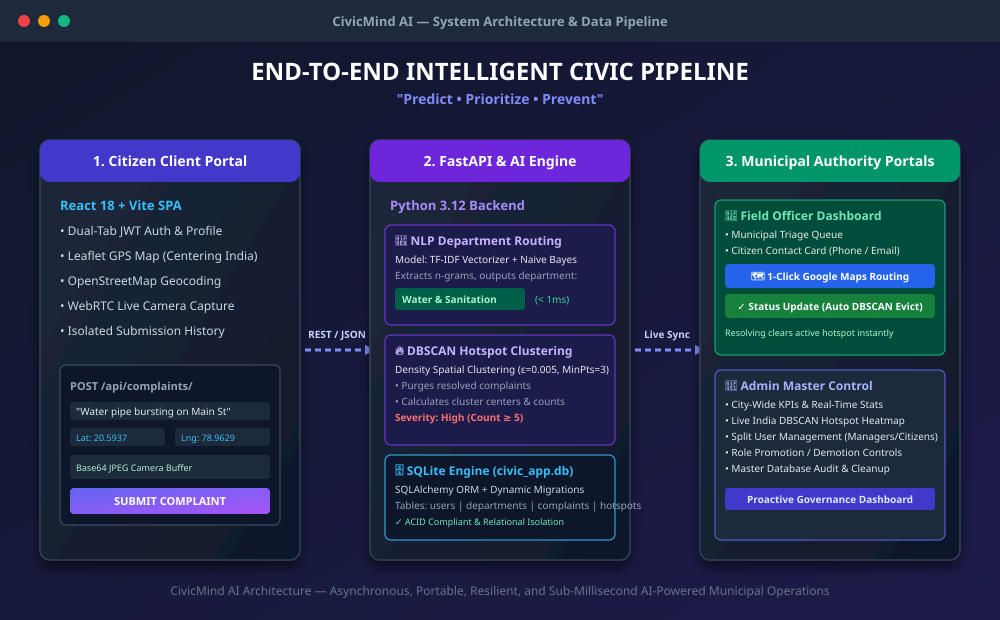
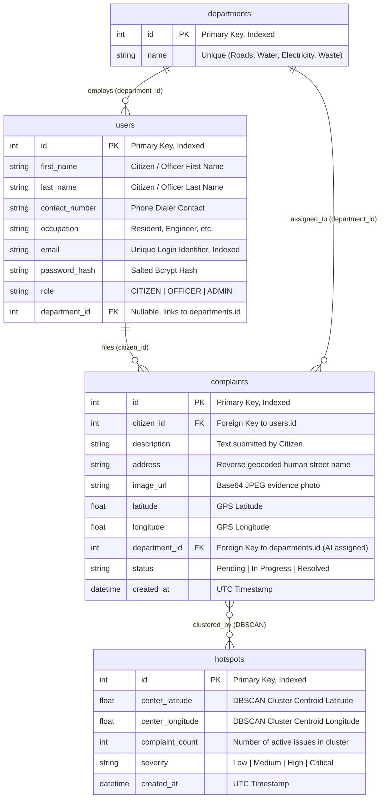
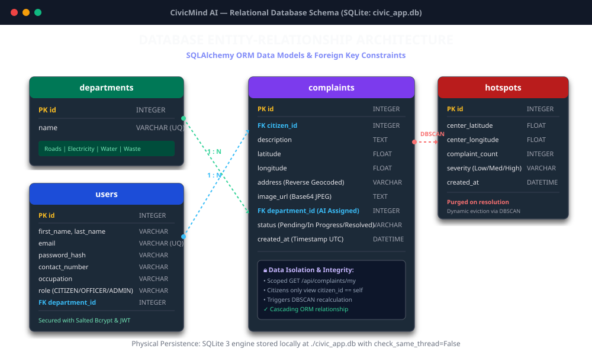
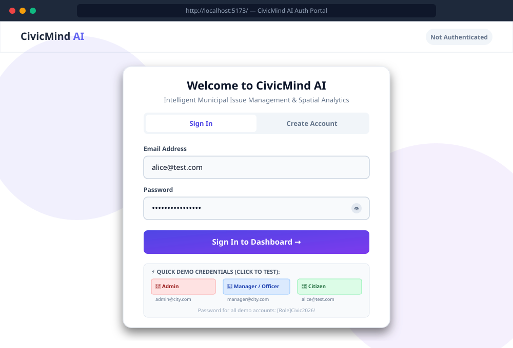
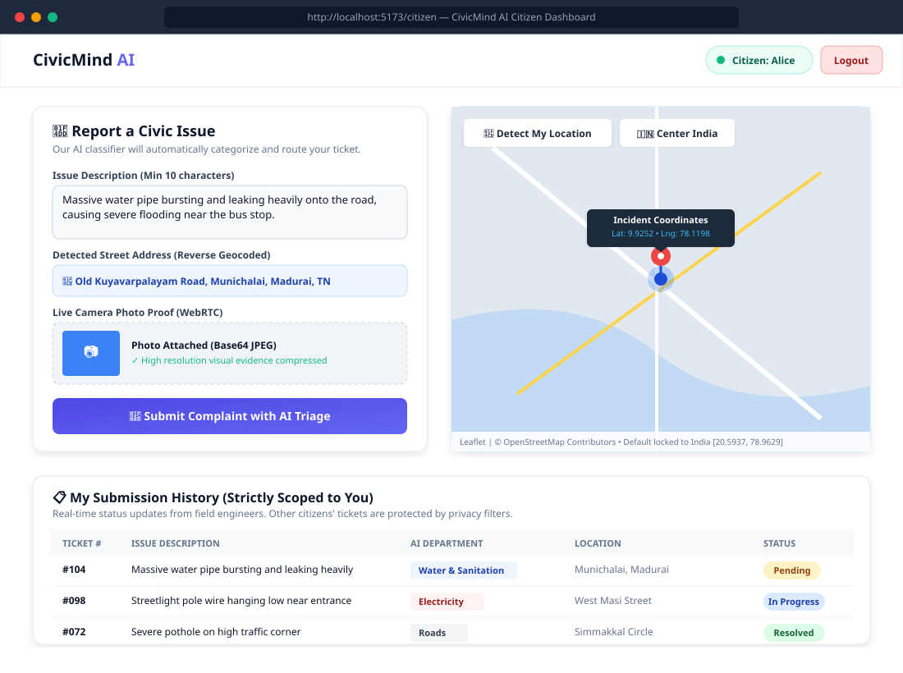
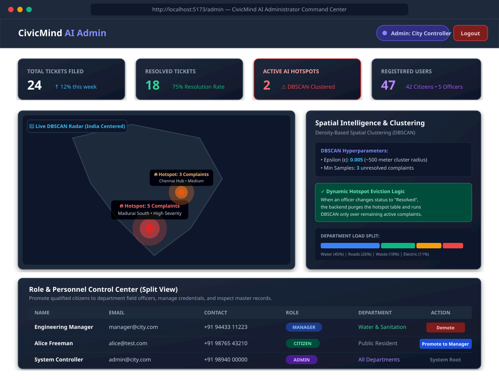
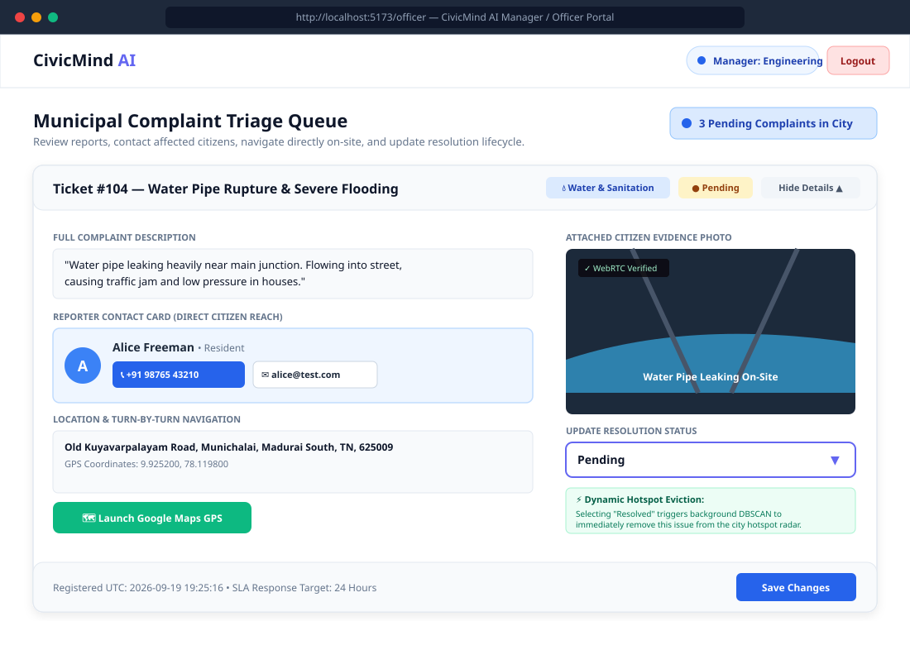

# CivicMind AI

> **"Predict • Prioritize • Prevent"**  
> *An AI-Powered Civic Issue Resolution, Autonomous Departmental Routing, and Spatial Hotspot Analytics Platform.*

[](https://fastapi.tiangolo.com/)
[](https://reactjs.org/)
[](https://vitejs.dev/)
[](https://tailwindcss.com/)
[](https://scikit-learn.org/)
[](https://www.sqlite.org/)
[](https://leafletjs.com/)

---

## 📑 Table of Contents

1. [Executive Overview & How the Project Works](#-how-the-project-works)
   - [End-to-End Operational Pipeline](#end-to-end-operational-pipeline)
   - [Architecture & Dataflow Diagram](#system-architecture-diagram)
2. [Database Architecture & Storage Engine](#-database-architecture--how-it-works)
   - [Physical Storage & Engine Details](#physical-storage--engine-details)
   - [Entity-Relationship Diagram (ERD)](#database-entity-relationship-diagram-erd)
   - [Detailed Table Schemas & Relationships](#detailed-table-schemas)
   - [Data Isolation & Dynamic Startup Auto-Migrations](#data-isolation--dynamic-migrations)
3. [Key Features: Importance, Technical Mechanisms & Screenshots](#-key-features-importance-mechanisms--screenshots)
   - [1. Dual-Tab Authentication & Citizen Profiling](#1-dual-tab-authentication--citizen-profiling)
   - [2. Interactive GIS Leaflet Mapping & Reverse Geocoding (India Default)](#2-interactive-gis-leaflet-mapping--reverse-geocoding-india-default)
   - [3. WebRTC In-Browser Live Camera Evidence Capture](#3-webrtc-in-browser-live-camera-evidence-capture)
   - [4. AI Department Routing (TF-IDF + Naive Bayes)](#4-ai-department-routing-tf-idf--naive-bayes)
   - [5. Spatial Density Hotspot Detection (DBSCAN)](#5-spatial-density-hotspot-detection-dbscan)
   - [6. Dynamic Hotspot Eviction on Issue Resolution](#6-dynamic-hotspot-eviction-on-issue-resolution)
   - [7. Field Officer Triage, Citizen Contact Cards & 1-Click Google Maps Routing](#7-field-officer-triage-citizen-contact-cards--1-click-google-maps-routing)
   - [8. Admin Command Center & Split User Management](#8-admin-command-center--split-user-management)
4. [Project Directory Structure](#-project-directory-structure)
5. [Getting Started (Windows PowerShell)](#-getting-started-windows-powershell)
6. [Default Demo Accounts](#-default-demo-accounts)

---

## 🔄 How the Project Works

Municipal governance has traditionally been plagued by three major bottlenecks:
1. **The Citizen Black Hole**: Citizens submit complaints without receiving actionable feedback, real-time status updates, or visual proof verification.
2. **Manual Department Triage**: Administrative officers spend days manually reading unstructured text to figure out which civic department (Roads, Water, Electricity, Waste) should resolve an issue.
3. **Reactive Rather Than Predictive Maintenance**: Municipalities fix symptoms individually (e.g., 10 separate pipe bursts on the same street) without identifying that the underlying water pipeline has structurally failed.

**CivicMind AI** shifts civic management from a slow, reactive paperwork process into an **autonomous, intelligent spatial pipeline**:

### End-to-End Operational Pipeline



### System Architecture Diagram

Below is the complete architectural layout showing how the React 18 client, FastAPI REST server, Machine Learning models, and SQLite database interact:



---

## 🗄️ Database Architecture & How It Works

### Physical Storage & Engine Details

- **Database Engine**: **SQLite 3** running via **SQLAlchemy ORM** (`sqlite:///./civic_app.db`).
- **File Location**: Root directory (`civic_app.db`). The database is entirely self-contained, requiring zero external server configuration (e.g., PostgreSQL or MySQL server daemons).
- **Thread Safety**: Initialized with `connect_args={"check_same_thread": False}` to allow concurrent async request threads handled by FastAPI/Uvicorn.
- **Relational Integrity**: Enforces foreign keys (`citizen_id -> users.id`, `department_id -> departments.id`) ensuring cascading integrity across all citizen complaints and municipal assignments.
- **ACID Compliance**: Full transaction atomicity, consistency, isolation, and durability. Status updates and hotspot calculations execute within scoped `SessionLocal` database sessions that automatically commit or roll back on error.

### Database Entity-Relationship Diagram (ERD)



### Visual Database Schema



### Detailed Table Schemas

#### 1. `users` Table
Stores all authenticated system actors (Citizens, Field Managers, and Administrators).
- `id` (`Integer`, PK, Index): Unique numeric identifier.
- `first_name` & `last_name` (`String`): User's legal names used to construct contact cards for field officers.
- `contact_number` (`String`): User's direct telephone number (powers the 1-click `tel:` phone dialer on the Officer Dashboard).
- `occupation` (`String`): Citizen's occupation (e.g., "Resident", "Business Owner", "Civil Engineer").
- `email` (`String`, Unique, Index): System login credential.
- `password_hash` (`String`): One-way salted hash generated using `bcrypt.hashpw()` with random salt rounds. Plaintext passwords are never stored.
- `role` (`String`): Access control role (`CITIZEN`, `OFFICER`/`MANAGER`, `HEAD`/`ADMIN`).
- `department_id` (`Integer`, FK): Department foreign key assigned to municipal officers.

#### 2. `departments` Table
Represents the municipal operating departments.
- `id` (`Integer`, PK, Index): Unique department identifier.
- `name` (`String`, Unique, Index): Pre-seeded or dynamically created by the AI engine:
  - `Roads`
  - `Electricity`
  - `Water & Sanitation`
  - `Waste Management`

#### 3. `complaints` Table
The primary transaction ledger storing civic issues.
- `id` (`Integer`, PK, Index): Unique ticket number (e.g., Ticket #104).
- `citizen_id` (`Integer`, FK -> `users.id`): Foreign key anchoring the ticket to the citizen who filed it.
- `description` (`String`): The raw natural language complaint filed by the user (validated $\ge 10$ characters).
- `address` (`String`): Human-readable street address obtained automatically via client-side OpenStreetMap Nominatim reverse geocoding.
- `image_url` (`String`): Full Base64 JPEG data URI (`data:image/jpeg;base64,...`) captured directly from the citizen's camera.
- `latitude` & `longitude` (`Float`): High-precision GIS coordinates chosen on the Leaflet map or detected via device GPS.
- `department_id` (`Integer`, FK -> `departments.id`): The department assigned autonomously by the TF-IDF Naive Bayes NLP model.
- `status` (`String`, default: `"Pending"`): Lifecycle status:
  - `Pending`: Newly submitted, awaiting field inspection.
  - `In Progress`: Acknowledged and under active field repair.
  - `Resolved`: Work complete; triggers immediate dynamic hotspot eviction.
- `created_at` (`DateTime`): Timestamp logged in UTC.

#### 4. `hotspots` Table
Transient spatial cluster table generated and dynamically maintained by the DBSCAN engine.
- `id` (`Integer`, PK, Index): Hotspot identifier.
- `center_latitude` & `center_longitude` (`Float`): Centroid coordinates of the spatial cluster.
- `complaint_count` (`Integer`): Number of unresolved complaints within $\approx 500\text{ meters}$.
- `severity` (`String`): Calculated based on volume (`High` for $\ge 5$ complaints, `Medium` otherwise).
- `created_at` (`DateTime`): Timestamp of detection.

### Data Isolation & Dynamic Migrations

1. **Citizen Privacy Scoping**:
   - The backend enforces strict relational isolation.
   - When a citizen accesses their dashboard, the frontend calls `GET /api/complaints/my`.
   - The backend executes:
     ```python
     db.query(Complaint).filter(Complaint.citizen_id == current_user.id).all()
     ```
   - Citizens can **never** see or query complaints filed by other users.
2. **Dynamic Startup Auto-Migrations (`backend/main.py`)**:
   - Rather than requiring destructive database drops or manual SQL scripts, the backend runs automated schema migrations on startup using `ALTER TABLE` statements wrapped in non-blocking safe blocks:
     ```python
     with engine.connect() as conn:
         for col, col_type in [("first_name", "VARCHAR"), ("last_name", "VARCHAR"), 
                               ("contact_number", "VARCHAR"), ("occupation", "VARCHAR")]:
             try:
                 conn.execute(text(f"ALTER TABLE users ADD COLUMN {col} {col_type}"))
                 conn.commit()
             except Exception:
                 pass # Column already exists
     ```
   - This guarantees that new profile fields and reverse-geocoded addresses are added seamlessly without losing existing test data.

---

## 🚀 Key Features: Importance, Mechanisms & Screenshots

---

### 1. Dual-Tab Authentication & Citizen Profiling



#### 🌟 Importance
A modern civic system must prevent anonymous spam while maintaining a friction-free onboarding experience. Requiring verified citizen contact details (Phone Number, Occupation, Legal Name) ensures field engineers can reach citizens directly for location clarifications, while role-based segregation ensures citizens cannot access administrative controls or view other users' tickets.

#### ⚙️ How It Works
- **Dual-Tab UI**: A single responsive card toggle (`Sign In` vs. `Create Account`) that eliminates clunky page reloads.
- **Bcrypt Salted Hashing**: Password strings are hashed using `bcrypt.hashpw(password.encode('utf-8'), bcrypt.gensalt())`.
- **JWT Token Issuance**: On successful authentication, the backend signs a JSON Web Token with the user's `id`, `sub` (email), `role`, and 24-hour expiration (`exp = datetime.utcnow() + timedelta(hours=24)`).
- **Automated Axios Interceptor**: In `frontend/src/api.js`, an Axios request interceptor reads `localStorage.getItem('token')` and injects `Authorization: Bearer <token>` into every outgoing HTTP request.
- **Quick Demo Credentials**: Pre-configured pills allow one-click role switching between Admin (`admin@city.com`), Officer (`manager@city.com`), and Citizen (`alice@test.com`).

---

### 2. Interactive GIS Leaflet Mapping & Reverse Geocoding (India Default)



#### 🌟 Importance
Text-only location descriptions (e.g., *"near the corner store"*) cause significant municipal delay because repair crews waste hours attempting to find the exact asset. By capturing high-precision latitude and longitude coordinates alongside a human-readable street address, repair crews can navigate directly to the incident site.

#### ⚙️ How It Works
- **India Default Centering**: The map defaults directly to India's geographic center (`[20.5937, 78.9629]`, zoom level 5) with `minZoom={4}` to prevent users from disorienting the viewport.
- **Map Size Invalidation**: The custom `MapController` component executes `map.invalidateSize()` upon mount, guaranteeing that Leaflet tile containers calculate correct dimensions without visual tile-clipping artifacts.
- **Device GPS Geolocation**: The `"📍 Detect My Location"` button invokes the browser's `navigator.geolocation.getCurrentPosition()`, centering the map directly over the citizen's current coordinates.
- **"🇮🇳 Center India" Quick Reset**: Allows citizens to instantly reset the map view back to the national overview if they zoom or pan away.
- **Nominatim Reverse Geocoding**: Every time a user clicks the map or their GPS location is detected, an asynchronous request is dispatched to OpenStreetMap's Nominatim service:
  ```javascript
  const res = await fetch(`https://nominatim.openstreetmap.org/reverse?format=json&lat=${lat}&lon=${lng}`);
  const data = await res.json();
  setAddress(data.display_name);
  ```
  The resulting street address is displayed in real-time and saved in the complaint record.

---

### 3. WebRTC In-Browser Live Camera Evidence Capture

#### 🌟 Importance
Municipalities often receive fraudulent, outdated, or exaggerated complaint reports. Enabling citizens to capture live on-site photo proof directly through their device's camera verifies that the issue is authentic, current, and physically located at the reported coordinates.

#### ⚙️ How It Works
- **WebRTC Camera Stream**: Invokes the browser-native `navigator.mediaDevices.getUserMedia({ video: true, audio: false })` API.
- **In-Memory Canvas Drawing**: When the citizen clicks `"Capture Photo"`, the video frame is drawn onto an HTML5 `<canvas>` element:
  ```javascript
  const canvas = canvasRef.current;
  const context = canvas.getContext('2d');
  context.drawImage(videoRef.current, 0, 0, canvas.width, canvas.height);
  const base64Image = canvas.toDataURL('image/jpeg', 0.8);
  setPhotoUrl(base64Image);
  ```
- **Client-Side Compression**: The image is downscaled and compressed to high-efficiency JPEG format, producing a lightweight Base64 string that is transmitted directly in the JSON payload, eliminating the need for costly external S3/cloud storage buckets.

---

### 4. AI Department Routing (TF-IDF + Naive Bayes)

#### 🌟 Importance
In conventional municipal portals, non-technical citizens are forced to manually select which government department handles their issue. When citizens select the wrong department (e.g., choosing "Roads" for a water pipe leak causing road flooding), the ticket languishes in administrative limbo for days. Autonomous AI routing categorizes complaints in less than **1 millisecond** with zero human triage overhead.

#### ⚙️ How It Works
- **Feature Extraction (`TfidfVectorizer`)**: Converts complaint descriptions into n-gram token frequency matrices, down-weighting ubiquitous words (like *"the"*, *"is"*, *"near"*) and emphasizing domain-specific civic terms (*"pothole"*, *"leakage"*, *"transformer"*, *"garbage"*).
- **Classification (`MultinomialNB`)**: Uses a Multinomial Naive Bayes model trained across thousands of civic complaints.
- **Sub-Millisecond Inference**: The vectorizer and model pipeline executes entirely in-memory (`backend/ai/nlp_classifier.py`), caching the trained model to `nlp_model.pkl`.
- **Dynamic Department Auto-Creation**: If an issue is classified into a department not yet present in the database, the backend automatically initializes that department record on-the-fly.

```
Incoming Text: "Water pipe bursting near market junction, severe flooding"
       │
       ▼ [TfidfVectorizer: n-grams & sublinear TF]
Feature Vector: [water: 0.58, pipe: 0.52, bursting: 0.44, flooding: 0.39]
       │
       ▼ [MultinomialNB: Bayes Probabilistic Inference]
Class Probabilities:
  • Water & Sanitation: 98.4%  <--- HIGHEST PROBABILITY
  • Roads:              1.2%
  • Waste Management:   0.3%
  • Electricity:        0.1%
       │
       ▼
Assigned: "Water & Sanitation" (department_id = 3)
```

---

### 5. Spatial Density Hotspot Detection (DBSCAN)



#### 🌟 Importance
A single pothole or water leak is an isolated maintenance ticket. However, **five water leaks within a 300-meter corridor indicate a systemic pipeline fracture**. Traditional municipal systems treat them as five disconnected tickets. CivicMind AI's spatial density clustering groups geographically contiguous complaints together, alerting municipal leadership to underlying infrastructure failures.

#### ⚙️ How It Works
- **Algorithm**: `sklearn.cluster.DBSCAN` (Density-Based Spatial Clustering of Applications with Noise).
- **Hyperparameters**:
  - $\varepsilon = 0.005$: Radians/Euclidean degree distance corresponding to an approximate **500-meter radius**.
  - $\text{MinPts} = 3$: Requires at least **3 complaints** within the radius to declare a valid hotspot.
- **Noise Outlier Rejection**: Isolated complaints with no neighboring issues receive label `-1` (noise) and are not falsely promoted to hotspots.
- **Centroid Calculation**: For each cluster, the engine computes the geographic mean $(\bar{\text{lat}}, \bar{\text{lng}})$ to anchor the center of the hotspot circle marker on the map.
- **Severity Classification**:
  - `High`: $\ge 5$ complaints in cluster (pulsating red marker).
  - `Medium`: $3\text{–}4$ complaints in cluster (pulsating orange marker).

---

### 6. Dynamic Hotspot Eviction on Issue Resolution

#### 🌟 Importance
A critical flaw in static GIS analytics is the "zombie hotspot" bug: after repair crews fix all water pipes or potholes in an area, the hotspot continues to render on the city dashboard because historical complaints remain in the database. CivicMind AI dynamically evicts resolved issues in real-time, guaranteeing that the map reflects true ground reality.

#### ⚙️ How It Works
1. When an officer changes a complaint status to `"Resolved"` (`PUT /api/complaints/{id}/status`) or an administrator deletes an erroneous ticket (`DELETE /api/complaints/{id}`), the backend immediately executes `detect_hotspots(db)`.
2. **Pre-Purge**: The backend clears the entire `hotspots` table:
   ```python
   db.query(Hotspot).delete()
   db.commit()
   ```
3. **Active Filter**: Queries **only unresolved complaints**:
   ```python
   active_complaints = db.query(Complaint).filter(Complaint.status != "Resolved").all()
   ```
4. **Re-clustering**: DBSCAN re-evaluates active complaints. If the number of unresolved complaints in that area has dropped below $\text{MinPts} = 3$, the hotspot is not regenerated and **disappears from the map instantly**.

---

### 7. Field Officer Triage, Citizen Contact Cards & 1-Click Google Maps Routing



#### 🌟 Importance
Field crews frequently struggle with two operational obstacles: (1) locating the exact reported site on their mobile devices, and (2) communicating with the reporting citizen to ask for gate codes, landmark details, or on-site access. The Officer Dashboard bridges this gap with instant contact cards and turn-by-turn navigation.

#### ⚙️ How It Works
- **Citizen Contact Card**: Displays the reporting citizen's Full Name, Occupation, Telephone Number, and Email Address.
  - **1-Click Call (`tel:`)**: Clicking the phone button opens the native phone dialer on mobile devices or softphones (`tel:+919876543210`).
  - **1-Click Email (`mailto:`)**: Opens the default mail client pre-addressed to the citizen.
- **1-Click Google Maps Turn-by-Turn Navigation**: Rather than loading heavyweight mapping SDKs on mobile devices, the officer portal provides a direct external navigation link:
  ```html
  <a href={`https://www.google.com/maps/dir/?api=1&destination=${c.latitude},${c.longitude}`} target="_blank">
    🗺️ Open in Google Maps
  </a>
  ```
  This opens the native **Google Maps app** on the officer's Android/iOS smartphone, providing turn-by-turn spoken GPS driving directions to the incident location.
- **Status Lifecycle Dropdown**: Allows officers to transition tickets from `Pending` $\to$ `In Progress` $\to$ `Resolved`.

---

### 8. Admin Command Center & Split User Management

#### 🌟 Importance
City leadership and chief municipal commissioners require high-level visibility across all departments, real-time KPI metrics, the ability to promote trusted citizens to department field officers, and a central audit hub to inspect system records.

#### ⚙️ How It Works
- **Real-Time KPI Metric Cards**:
  - `Total Tickets`: Aggregated count of all city-wide submissions.
  - `Resolved Tickets`: Completed repairs with real-time percentage resolution rate.
  - `Active Hotspots`: Live count of DBSCAN-detected problem areas.
  - `Registered Users`: Breakdown of citizens vs. active field managers.
- **Split User Management View**:
  - Explicitly separates **Department Managers** from **Citizens** in dedicated tables.
  - Allows 1-click **Promotion** (converting an active citizen into a field officer) and **Demotion** (reverting an officer to citizen status).
- **Master Database Inspector**: Paginated audit table allowing system administrators to inspect, search, and delete invalid complaints across all municipal departments.

---

## 📂 Project Directory Structure

```
civicmindai/
├── backend/                        # FastAPI REST API & AI engine
│   ├── ai/                         # Machine Learning pipelines
│   │   ├── hotspot_detector.py     # DBSCAN spatial clustering & dynamic eviction
│   │   └── nlp_classifier.py       # TF-IDF + Naive Bayes department router
│   ├── routes/                     # Modular API endpoints
│   │   ├── auth.py                 # Salted Bcrypt registration & JWT authentication
│   │   ├── complaints.py           # Complaint CRUD, /my isolation, & status updates
│   │   └── dashboard.py            # KPI metrics, live hotspot data & user roles
│   ├── database.py                 # SQLAlchemy SQLite engine & session generator
│   ├── main.py                     # FastAPI entrypoint, CORS, & startup migrations
│   └── models.py                   # SQLAlchemy models (User, Department, Complaint, Hotspot)
│
├── frontend/                       # React 18 + Vite + Tailwind CSS SPA
│   ├── src/
│   │   ├── pages/                  # Role-based dashboard interfaces
│   │   │   ├── AdminDashboard.jsx  # KPI metrics, DBSCAN radar & user management
│   │   │   ├── CitizenDashboard.jsx# Issue submission, Leaflet map & WebRTC camera
│   │   │   └── OfficerDashboard.jsx# City complaints queue, contact cards & GPS routing
│   │   ├── api.js                  # Axios client with automated JWT Bearer headers
│   │   ├── App.jsx                 # Routing shell & dual-tab Sign In / Sign Up portal
│   │   ├── index.css               # Tailwind directives & custom utilities
│   │   ├── main.jsx                # React DOM entrypoint
│   │   └── ToastContext.jsx        # Modern asynchronous toast notification engine
│   ├── index.html                  # HTML5 shell
│   ├── package.json                # Frontend dependencies & scripts
│   ├── postcss.config.js           # PostCSS configuration
│   ├── tailwind.config.js          # Tailwind styling rules
│   └── vite.config.js              # Vite dev server configuration
│
├── docs/                           # Documentation & architecture assets
│   ├── screenshots/                # Visual architecture & interface diagrams
│   │   ├── architecture_flow.svg   # High-level system architecture & data pipeline
│   │   ├── database_schema.svg     # SQLite database ER diagram & schema specifications
│   │   ├── auth_portal.svg         # Dual-tab Sign In & Create Account screen
│   │   ├── citizen_dashboard.svg   # Citizen reporting portal & personal history
│   │   ├── officer_dashboard.svg   # Officer triage queue, contact cards & GPS routing
│   │   └── admin_dashboard.svg     # Admin KPIs, India hotspot radar & user management
│   ├── ARCHITECTURE.md             # In-depth architectural specifications
│   ├── PROJECT_DEEP_DIVE.md        # Exhaustive technology stack justification
│   └── PROJECT_REPORT.md           # Formal 5-chapter project report
│
├── CivicMind_AI_Project_Report.doc # Microsoft Word (.doc) 5-chapter project report
├── CivicMind_AI_Technology_Deep_Dive.doc # Microsoft Word (.doc) tech justification doc
├── civic_app.db                    # Local SQLite database file (generated automatically)
├── requirements.txt                # Python backend dependencies
├── seed.py                         # Initial database seeder with demo accounts
├── start_backend.ps1               # PowerShell backend startup script
└── README.md                       # Comprehensive project documentation
```

---

## ⚡ Getting Started (Windows PowerShell)

### Prerequisites
- **Python 3.10+** installed and added to `PATH`
- **Node.js 18+** and **npm** installed
- **Windows PowerShell**

---

### Step 1: Backend Setup

Open a PowerShell terminal in the project root directory:

```powershell
# 1. Create a Python virtual environment
python -m venv backend\venv

# 2. Install backend dependencies
.\backend\venv\Scripts\pip.exe install -r requirements.txt

# 3. Seed the database with initial departments and demo accounts
python seed.py
```

---

### Step 2: Frontend Setup

Open a second PowerShell terminal in the project root directory:

```powershell
# 1. Navigate to the frontend directory
cd frontend

# 2. Install Node dependencies
npm install --legacy-peer-deps

# 3. Return to root
cd ..
```

---

### Step 3: Run the Application

#### Start the Backend (Terminal 1):
```powershell
.\start_backend.ps1
```
- **FastAPI REST API**: `http://localhost:8000`
- **Interactive Swagger Documentation**: `http://localhost:8000/docs`
- **Alternative ReDoc Documentation**: `http://localhost:8000/redoc`

#### Start the Frontend (Terminal 2):
```powershell
cd frontend
npm run dev
```
- **Web Application Portal**: `http://localhost:5173`

---

## 🔑 Default Demo Accounts

The database seeder (`seed.py`) configures three ready-to-test accounts representing each role in the system:

| Role | Email Address | Password | Primary Permissions & Features |
| :--- | :--- | :--- | :--- |
| 👑 **Administrator** | `admin@city.com` | `AdminCivic2026!` | City KPIs, India DBSCAN Hotspot Heatmap, Split User Role Management, Master Database Inspector |
| 👮 **Manager / Officer**| `manager@city.com` | `ManagerCivic2026!` | City Complaint Queue, Citizen Contact Cards (1-click call/email), 1-Click Google Maps turn-by-turn routing, Status Updates |
| 👤 **Citizen** | `alice@test.com` | `AliceCivic2026!` | Issue Reporting, Leaflet India GPS Map, WebRTC Live Camera Capture, Reverse Geocoding, Scoped Submission History |

*(New citizens can also register their own personal profile directly from the landing page using the **Create Account** tab).*

---

## 📜 License & Academic Integrity

Developed for Municipal Infrastructure Analytics and Smart City Research.  
**Motto:** *"Predict • Prioritize • Prevent"*
